# NeuroPilot components · Компоненты из шортсов

React components from the [@NeuroP1lot](https://www.youtube.com/@NeuroP1lot) Shorts. No UI libraries (Material You uses Google's color utilities): each component is one file (or one folder) you can copy into your project. Every demo works in Russian and English.

**▶ Live demo:** https://arthurkrantsevich.github.io/neuropilot-components/

| Component | Short | Demo | Code |
|---|---|---|---|
| [Claymorphism: 3 shadows on a button](#claymorphism-3-shadows-on-a-button) — outer shadow, dark inset, inset highlight; dark text of the same hue | [▶](https://youtube.com/shorts/ot7WmfSWik0) | [open](https://arthurkrantsevich.github.io/neuropilot-components/#clay) | [`clay/`](src/components/clay) |
| [Neubrutalism: 0 blurs, 0 gradients](#neubrutalism-0-blurs-0-gradients) — flat color, a 3px border, a hard 6px 6px 0 shadow; two bright colors | [▶](https://youtube.com/shorts/1uBXlyDk0-I) | [open](https://arthurkrantsevich.github.io/neuropilot-components/#brutal) | [`brutal/`](src/components/brutal) |
| [Neumorphism: find the buttons](#neumorphism-find-the-buttons) — soft UI with a 1.7:1 edge, and the fix that keeps it soft | [▶](https://youtube.com/shorts/q1_Kw0J78jM) | [open](https://arthurkrantsevich.github.io/neuropilot-components/#neu) | [`neu/`](src/components/neu) |
| [Bento grid](#bento-grid) — 2 lines of CSS: one hero tile, the eye knows where to look | [▶](https://youtube.com/shorts/6o7kNb_TJIA) | [open](https://arthurkrantsevich.github.io/neuropilot-components/#bento) | [`bento/`](src/components/bento) |
| [Material You](#material-you) — one wallpaper color → 29 UI color roles | [▶](https://youtube.com/shorts/D_9AeA0thmY) | [open](https://arthurkrantsevich.github.io/neuropilot-components/#material) | [`material-you/`](src/components/material-you) |
| [Card → page](#card--page-view-transitions) — the image and title fly into the new page | [▶](https://youtube.com/shorts/-ChwLWTUI4E) | [open](https://arthurkrantsevich.github.io/neuropilot-components/#card) | [`card-transition/`](src/components/card-transition) |
| [Dynamic Island](#dynamic-island) — one pill becomes a timer, a player and a call | [▶](https://youtube.com/shorts/BJfNxnVbyAA) | [open](https://arthurkrantsevich.github.io/neuropilot-components/#island) | [`dynamic-island/`](src/components/dynamic-island) |
| [Date range picker](#date-range-picker) — two months, hover preview, presets | [▶](https://youtube.com/shorts/qNPflv57UsI) | [open](https://arthurkrantsevich.github.io/neuropilot-components/#range-picker) | [`range-picker/`](src/components/range-picker) |
| [Magnetic button](#magnetic-button) — the duel: regular vs magnetic | [▶](https://youtube.com/shorts/38HDRVJWjA8) | [open](https://arthurkrantsevich.github.io/neuropilot-components/#magnetic) | [`MagneticButton.tsx`](src/components/MagneticButton.tsx) |
| [3D tilt card](#3d-tilt-card) — layers at different depths, glare | [▶](https://youtube.com/shorts/_QfrxuaAH7I) | [open](https://arthurkrantsevich.github.io/neuropilot-components/#tilt) | [`TiltCard.tsx`](src/components/TiltCard.tsx) |
| [Password field with a face](#password-field-with-a-face) — panics at 1234 | [▶](https://youtube.com/shorts/XY2tdBYOjA0) | [open](https://arthurkrantsevich.github.io/neuropilot-components/#password) | [`PasswordFace.tsx`](src/components/PasswordFace.tsx) |
| [Day/night toggle](#daynight-toggle) — the sun becomes a moon with one inset shadow | [▶](https://youtube.com/shorts/HoWS3tF59pc) | [open](https://arthurkrantsevich.github.io/neuropilot-components/#toggle) | [`ThemeToggle.tsx`](src/components/ThemeToggle.tsx) |
| [Runaway button](#runaway-button) — the Subscribe button you can't click | [▶](https://youtube.com/shorts/L5WUOrv_Ojs) | [open](https://arthurkrantsevich.github.io/neuropilot-components/#runaway) | [`RunawayButton.tsx`](src/components/RunawayButton.tsx) |

Styles for each component live in [`src/gallery.css`](src/gallery.css) under a comment with its name (except `card-transition/`, `dynamic-island/` and `range-picker/`, which carry their own CSS).

---

### Claymorphism: 3 shadows on a button

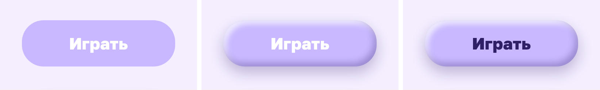

```tsx
import { ClayButton, ClayApp, ALL } from "./components/clay/Clay";

<ClayButton label="Play" hue="lilac" ink={1} />                          // all three shadows, dark text
<ClayButton label="Play" layers={{ outer: 1, dark: 1, light: 0 }} />     // any shadow at any strength 0–1
<ClayApp lang="en" ink={1} layers={ALL} />                               // the kids' screen from the Short, 393×852
```

- One `box-shadow` with three parts, each in its own constant (`SHADOWS`), so you can switch them on one at a time:
  - `0 18px 36px rgba(60,40,120,.28)`: the soft outer shadow, which lifts the button off the background;
  - `inset -8px -10px 18px rgba(40,20,90,.28)`: dark inside at the bottom right, which gives it volume;
  - `inset 8px 10px 16px rgba(255,255,255,.75)`: a highlight inside at the top left, which gives it gloss.
- Michał Malewicz named the style in 2021 ([Claymorphism in User Interfaces](https://hype4.academy/articles/design/claymorphism-in-user-interfaces)), and he admits it looks "slightly child-like".
- The trap is white text on pastel: 1.8:1 on lilac `#C9B8FF`, which fails even the 3:1 minimum for large text ([WCAG 1.4.3](https://www.w3.org/WAI/WCAG21/Understanding/contrast-minimum)). The fix is a dark color of the same hue: `#2E1F66` gives 7.8:1, and the pastel stays.
- `ink` goes from 0 to 1 (white → dark), so the text color can be animated. The demo computes the contrast live with the WCAG formula (`contrast()`).
- Five ready hues: `lilac`, `sky`, `pink`, `mint`, `sun`, each a pastel plus a dark ink of the same hue.

### Neubrutalism: 0 blurs, 0 gradients

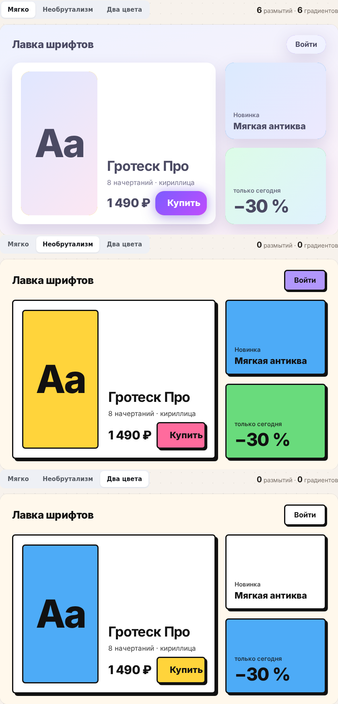

```tsx
import { BrutalShop, SOFT, BRUTAL, TWO_COLORS } from "./components/brutal/Brutal";

<BrutalShop lang="en" st={SOFT} />        // soft SaaS: 6 blurred shadows, 6 gradients
<BrutalShop lang="en" st={BRUTAL} />      // 0 and 0: flat color, 3px border, 6px 6px 0 #111
<BrutalShop lang="en" st={TWO_COLORS} />  // two bright colors instead of five
```

- `st` is continuous (`g`, `s`, `b`, `c` from 0 to 1, plus `press`), so every step can be animated. The demo counts blurs and gradients from the rendered DOM (`getComputedStyle`).
- `box-shadow: 6px 6px 0 #111`: the third number is the blur radius, and 0 gives a sharp edge ([MDN](https://developer.mozilla.org/en-US/docs/Web/CSS/box-shadow)).
- Press: `transform: translate(…)` by the shadow offset plus `box-shadow: none`. The button sits into its shadow, no animation needed.
- NN/g advises 2–3 bold colors ([Neobrutalism: Definition and Best Practices](https://www.nngroup.com/articles/neobrutalism/)): here yellow for the main button and blue for backgrounds, the rest black and white. Black text on these colors is 8.5–14.7:1; white text fails.
- Colors change through white, not directly. Yellow → blue in a straight line passes through muddy grey.

### Neumorphism: find the buttons

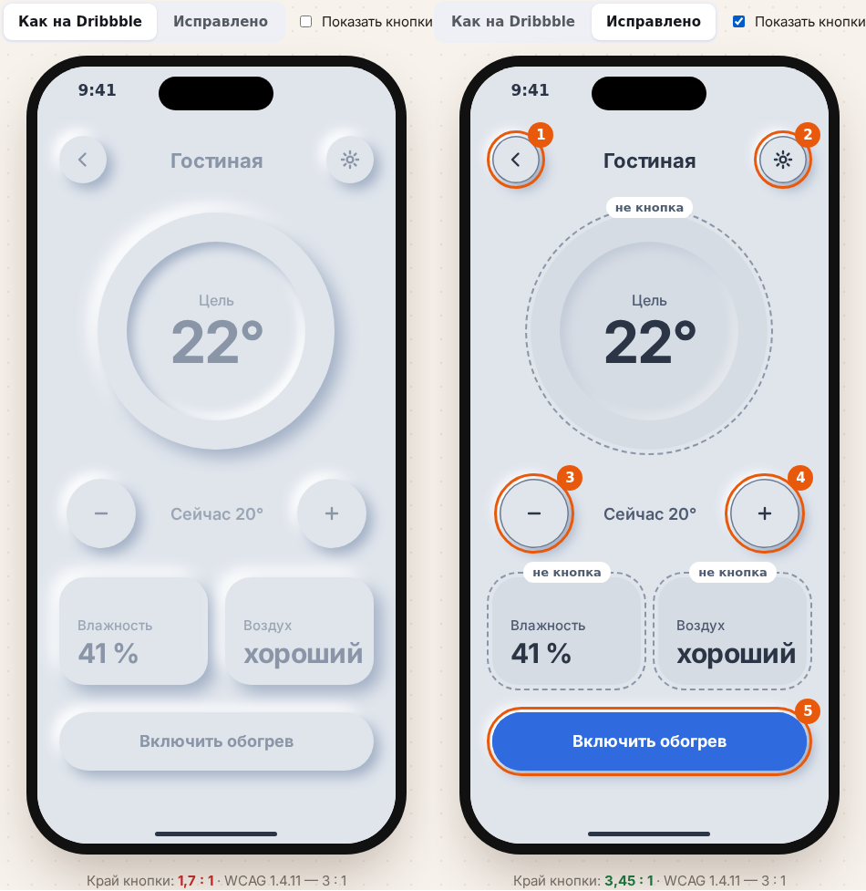

```tsx
import { NeuScreen } from "./components/neu/Neu";

<NeuScreen lang="en" fix={0} />   // the Dribbble look: 5 buttons, 3 raised tiles that aren't buttons
<NeuScreen lang="en" fix={1} />   // fixed: still soft, but you can see what to press
```

- Neumorphism makes a button from the background color (`#E0E5EC`) with two shadows: light top-left, dark bottom-right. The edge is only a shadow: even the shadow color is 1.72:1 against the background.
- If a button is recognized only by its shape, WCAG 2.1 SC 1.4.11 asks for 3:1 on its edge ([Understanding 1.4.11](https://www.w3.org/WAI/WCAG21/Understanding/non-text-contrast.html)). With contrasting text or a contrasting icon, a border isn't required.
- The fix (`fix` 0 → 1, animatable): a 1px border `#6B7A90` (3.45:1), color on the main button with white text, flat cards (what can't be pressed shouldn't stick out), icons and labels at 9.6:1 and 5:1.
- Contrast numbers are computed with the WCAG relative-luminance formula.

### Bento grid

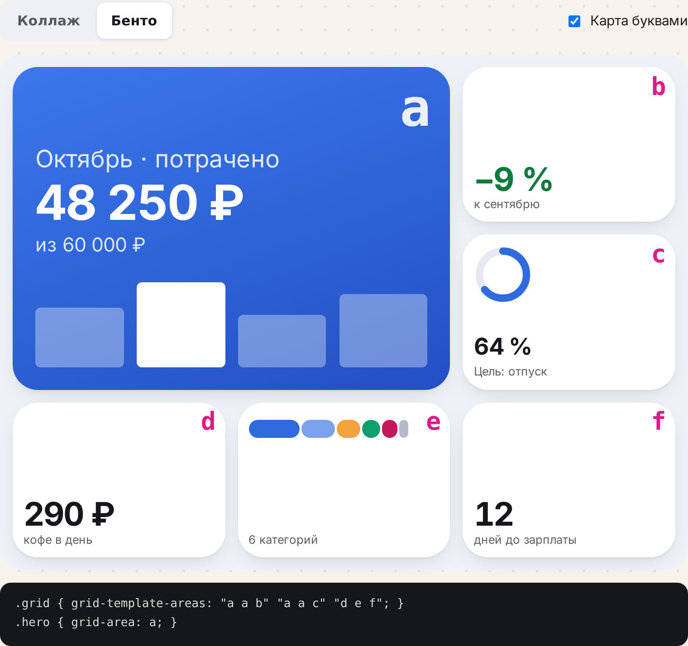

```tsx
import { Bento } from "./components/bento/Bento";
import { LAYOUTS } from "./components/bento/bento";

<Bento layout={LAYOUTS.bento} lang="en" letters />
```

```css
.grid { grid-template-areas: "a a b" "a a c" "d e f"; }
.hero { grid-area: a; }
@media (width < 600px) { .grid { grid-template-areas: "a a" "b c" "d d" "e f"; } }
```

- `grid-template-areas` is the layout drawn in letters. Repeat a letter and that tile spans more cells. Areas must be rectangles; `.` is an empty cell ([MDN](https://developer.mozilla.org/en-US/docs/Web/CSS/grid-template-areas)).
- Six equal tiles give the eye nowhere to land. One tile four cells big tells it where to look first: size is a marker of importance ([NN/g](https://www.nngroup.com/articles/visual-hierarchy-ux-definition/)).
- On a phone only the map changes; the markup stays the same. Tiles are size containers, so text scales with each tile (`cqmin`).
- Tab and screen readers follow the HTML order, not the picture: keep the hero first in the markup.
- Works in every browser since 2017 (Chrome 57, Firefox 52, Safari 10.1, Edge 16).

### Material You

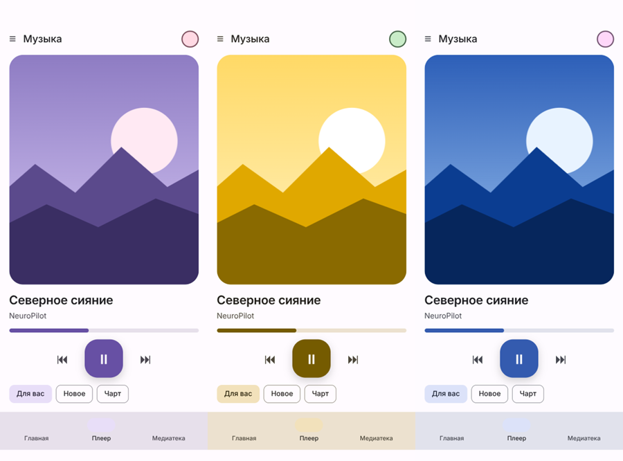

```tsx
import { MaterialPlayer, rolesFromSeed, cssVars } from "./components/material-you/MaterialYou";

<MaterialPlayer seed="#6750A4" text={…} wallpaper={url} />
// or just the colors: <div style={cssVars(rolesFromSeed("#F4C430"))}>…uses var(--md-primary)…</div>
```

- `themeFromSourceColor(seed)` from Google's `@material/material-color-utilities` builds 6 tonal palettes in the HCT color space and 29 color roles: primary, onPrimary, surface, primaryContainer…
- Every role becomes a CSS variable `--md-*`; the UI is painted only with those variables, so changing one seed recolors everything.
- Contrast holds for any seed: even from yellow (#F4C430) the button becomes #755B00 with 6.5:1 text contrast. The demo shows the live ratio.
- The only dependency besides React: `@material/material-color-utilities` (Apache-2.0, by Google).

### Card → page (View Transitions)

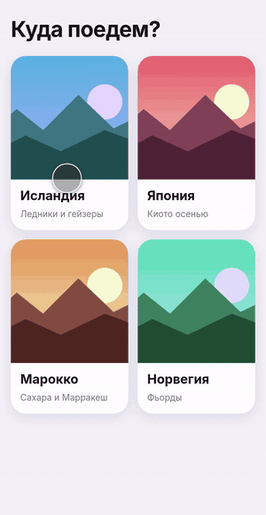

```tsx
import { CardTransition } from "./components/card-transition/CardTransition";

<CardTransition heading="Where to next?" places={places} labels={{ back: "Back", book: "Book now", nights: "7 nights" }} />
```

- The image and the title carry the same `view-transition-name` on the card and on the page. The browser snapshots both states and animates between them.
- In React the state change runs inside `document.startViewTransition(() => flushSync(update))`, so the new page is already in the DOM when the browser takes the "after" snapshot.
- Works with stable React 19: no canary `<ViewTransition>` and no libraries. Browsers without the API switch instantly.
- **Responsive via container queries.** It adapts to the width of its container, not the window: 2 columns on a phone, 3 on a tablet, 4 on desktop. On wide screens the place page splits into image and text. It is checked at 375, 393, 768, 1024, 1280, 1440 and 1920 px with no overflow.

| Phone · tablet | Desktop |
|---|---|
| 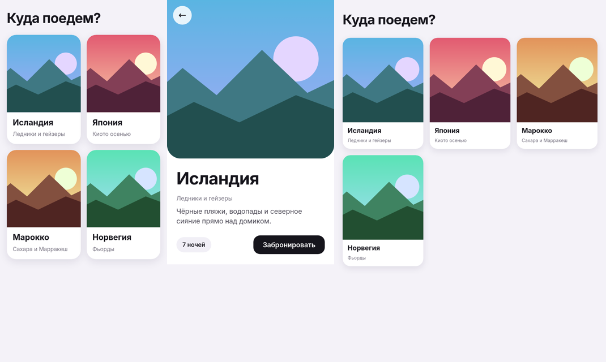 | 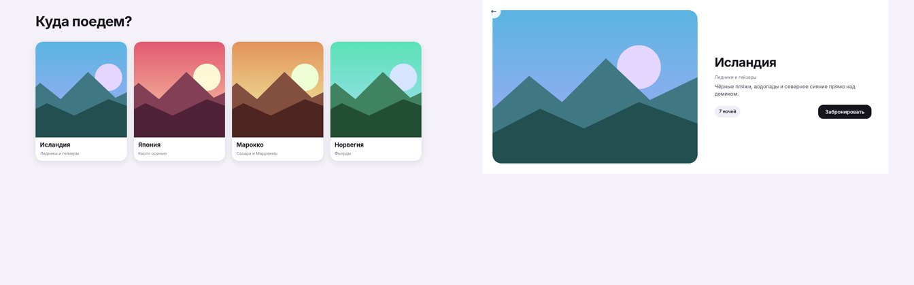 |

### Dynamic Island

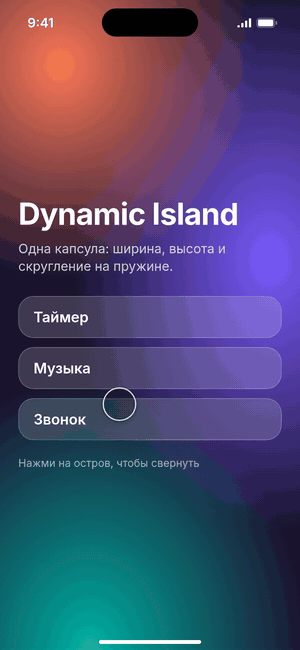

```tsx
import { DynamicIsland, type IslandMode } from "./components/dynamic-island/DynamicIsland";

const [mode, setMode] = useState<IslandMode>("idle"); // "idle" | "timer" | "music" | "call"
<DynamicIsland mode={mode} text={{ calling: "Incoming call", caller: "Anna", song: "Northern Lights", artist: "NeuroPilot" }} onClose={() => setMode("idle")} />
```

- The whole morph is three properties on one element: `width`, `height` and `border-radius`. Each mode only sets `--w`, `--h` and `--r`.
- The spring is a CSS `linear()` easing, a damped spring sampled into 25 points. There is no JavaScript animation.
- Content remounts per mode (`key={mode}`) and fades in out of a blur, 0.18 s after the shape.
- `IslandPhone` is a 393×852 pt iPhone 15 Pro screen with the island at the camera, a status bar and the 59/34 pt safe areas.

### Date range picker

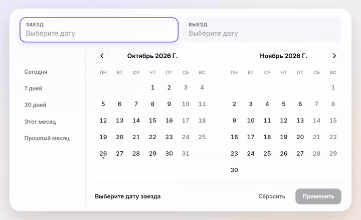

```tsx
import { RangePicker, type Range } from "./components/range-picker/RangePicker";

const [range, setRange] = useState<Range>({ start: null, end: null });
<RangePicker lang="en" today={new Date()} value={range} onChange={setRange} onApply={save} />
```

- Two months side by side. The whole strip of months slides on ←/→, and the month titles slide with it.
- Hover preview: after the first click, the range lights up as far as the cursor, across the month boundary.
- The solid band is one `::before` per cell. It starts from the middle of the start cell and ends at the middle of the end cell, with rounded ends at week edges.
- Presets: today, 7 days, 30 days, this month, last month. On narrow screens it shows one month.
- `lang="ru" | "en"`: month names come from `Intl.DateTimeFormat`. The week starts on Monday in RU and on Sunday in EN.

### Magnetic button

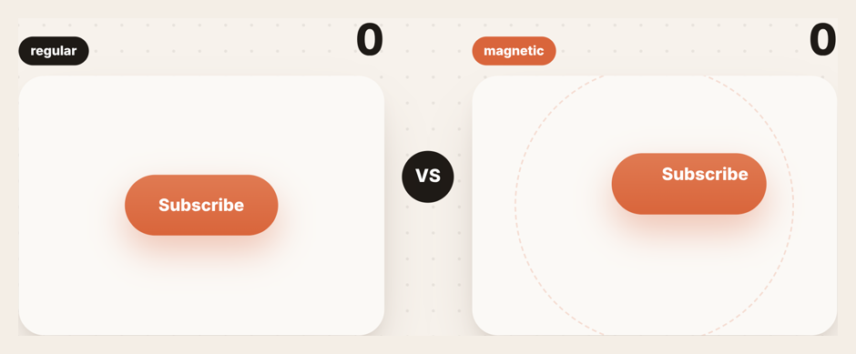

```tsx
import { MagneticButton } from "./components/MagneticButton";

<MagneticButton onClick={subscribe}>Subscribe</MagneticButton>
<MagneticButton flat onClick={subscribe}>Subscribe</MagneticButton> {/* regular button, for comparison */}
```

- Within `radius` (140 px) the button moves toward the cursor by `strength` (35 %) of the distance. The label moves another 45 % on top of that, which reads as depth.
- A magnetic button catches clicks anywhere in its radius; a regular one only on itself. The demo counts both: that's the duel from the Short.
- A click sends a ring wave; leaving the field springs the button back.

### 3D tilt card

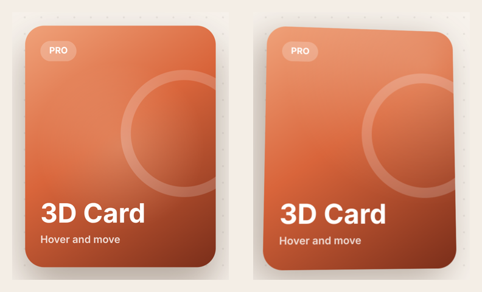

```tsx
import { TiltCard } from "./components/TiltCard";

<TiltCard title="3D Card" sub="Hover and move" chip="PRO" />
```

- `perspective` on the stage and `rotateX`/`rotateY` on the card from the cursor position (±18°).
- The chip, title, subtitle and ring sit at different `translateZ` depths inside `transform-style: preserve-3d`, so they separate as the card tilts.
- A radial glare follows the cursor (`--gx`, `--gy`), and the shadow moves the opposite way.

### Password field with a face

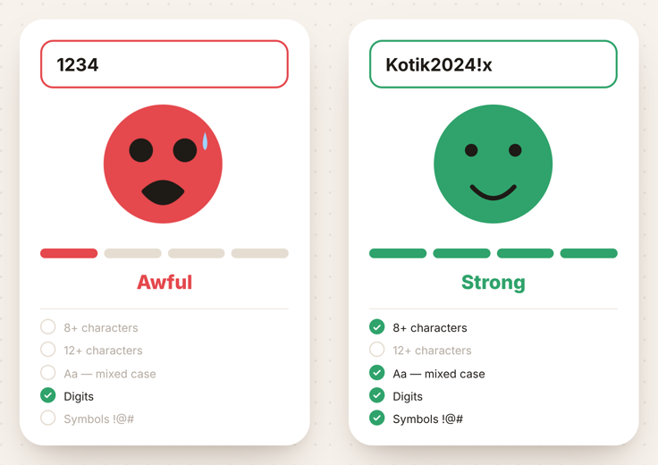

```tsx
import { PasswordFace } from "./components/PasswordFace";

<PasswordFace t={{ placeholder: "Try 1234", empty: "Type a password", moods: ["Awful", "Weak", "Okay", "Strong"], checks: ["8+ characters", "12+ characters", "Aa — mixed case", "Digits", "Symbols !@#"] }} />
```

- `strength()` counts five checks: length ≥ 8, length ≥ 12, mixed case, digits and symbols, and turns them into a level from 0 to 3 (0–2 checks → 1, 3 → 2, 4–5 → 3). Common passwords (`1234…`, `qwerty`, `password`, `пароль`, with or without trailing digits), one repeated character and anything shorter than 6 are 0. A strong password that merely starts with `1234` is not punished.
- Letter classes are Unicode-aware (`\p{Lu}`, `\p{Ll}`), so Cyrillic and other scripts count as letters with case, not as symbols.
- The face is one SVG. The eyes shrink and the mouth goes from an open scream to a smile. On level 0 it shakes and sweats.
- The input border, the 4-segment meter and the label all share one `--mood` colour.

### Day/night toggle

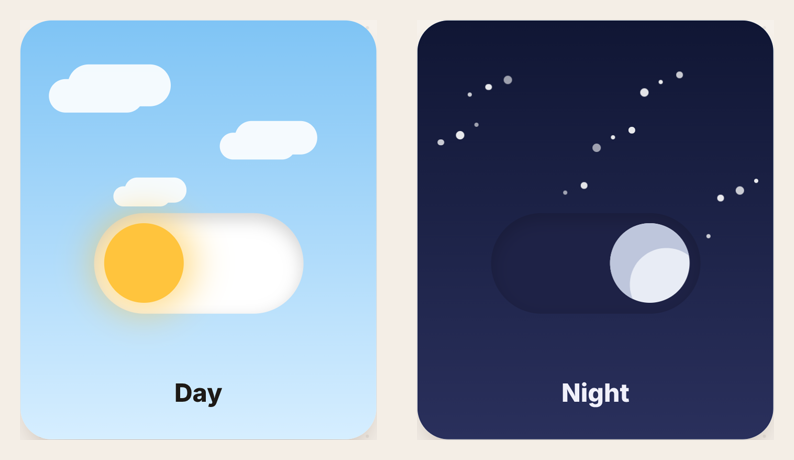

```tsx
import { ThemeToggle } from "./components/ThemeToggle";

const [night, setNight] = useState(false);
<ThemeToggle checked={night} onChange={setNight} labels={["Day", "Night"]} />
```

- The knob is a yellow circle. At night it rotates 200° and gets one `inset` shadow, `inset -22px -14px 0 3px`, which turns the circle into a crescent moon.
- The sky cross-fades to night, the clouds drift away and 22 stars light up and twinkle. All of it runs on CSS transitions toggled by one class.
- It is a real `<input type="checkbox">`, so it works with the keyboard and screen readers.

### Runaway button

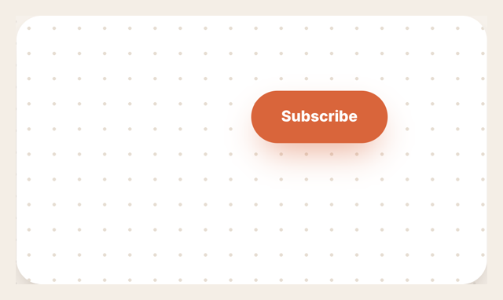

```tsx
import { RunawayButton } from "./components/RunawayButton";

<RunawayButton>Subscribe</RunawayButton>
```

- When the cursor comes within `radius` (110 px), the button jumps `step` (90 px) directly away from it.
- It can't leave the card. When it hits an edge, it bounces back toward the centre.

---

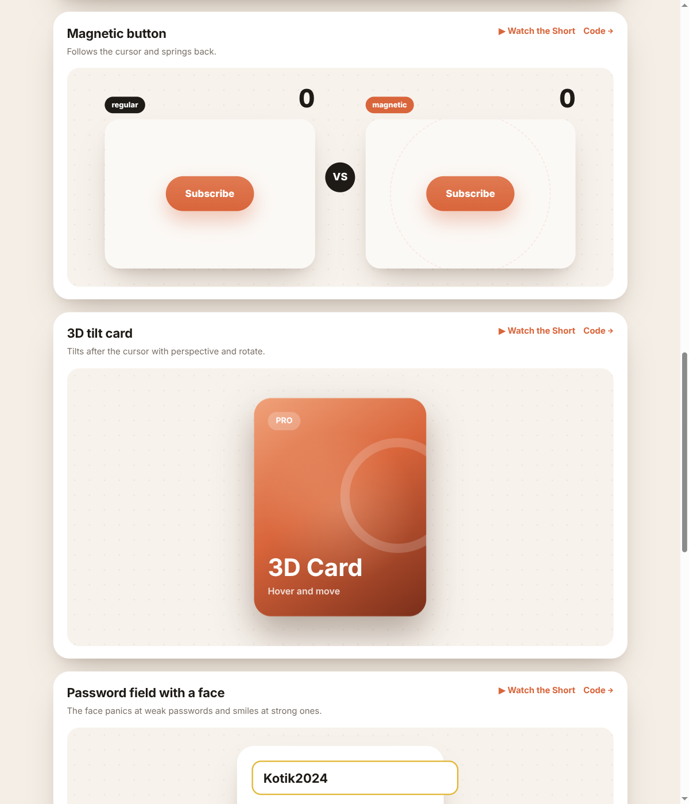

### Run

```bash
npm install
npm run dev     # http://localhost:5197
```

Vite + React 19 + TypeScript. MIT.

---

## По-русски

React-компоненты из шортсов канала [@NeuroP1lot](https://www.youtube.com/@NeuroP1lot). Без библиотек: каждый лежит в одном файле или папке, можно просто скопировать. Живое демо со всеми компонентами (RU/EN): https://arthurkrantsevich.github.io/neuropilot-components/

- **[Клейморфизм: 3 тени на кнопку](https://arthurkrantsevich.github.io/neuropilot-components/#clay)**: пластилиновая кнопка — одна box-shadow из трёх частей: мягкая снаружи, тёмная внутри снизу справа, блик внутри сверху слева. Ловушка — белый текст на пастели (1,8 : 1); починка — тёмный того же оттенка (7,8 : 1). Тени включаются по одной.
- **[Необрутализм: 0 размытий, 0 градиентов](https://arthurkrantsevich.github.io/neuropilot-components/#brutal)**: плоский цвет, рамка 3 px и жёсткая тень без размытия; нажатие — кнопка садится в тень; ярких цветов два, не пять (совет NN/g: 2–3).
- **[Неоморфизм: найди кнопки](https://arthurkrantsevich.github.io/neuropilot-components/#neu)**: кнопка цвета фона и две тени — край 1,7 : 1, кнопки сливаются с плитками. Исправление без потери мягкости: рамка 1 px (3,45 : 1), цвет главной кнопки, плоские плитки.
- **[Бенто-сетка](https://arthurkrantsevich.github.io/neuropilot-components/#bento)**: две строки CSS — карта `grid-template-areas` буквами и `grid-area` у главной плитки. Одна плитка крупнее — и взгляд знает, куда смотреть; на телефоне меняется только карта.
- **[Material You](https://arthurkrantsevich.github.io/neuropilot-components/#material)**: один цвет с обоев → 29 цветов интерфейса функцией Google themeFromSourceColor; контраст держится даже у жёлтого.
- **[Карточка → страница](https://arthurkrantsevich.github.io/neuropilot-components/#card)**: картинка и заголовок перелетают на новую страницу. Это View Transitions API браузера, без библиотек.
- **[Dynamic Island](https://arthurkrantsevich.github.io/neuropilot-components/#island)**: одна чёрная капсула превращается в таймер, плеер и звонок. Меняются только ширина, высота и скругление, пружина сделана на CSS `linear()`.
- **[Выбор диапазона дат](https://arthurkrantsevich.github.io/neuropilot-components/#range-picker)**: два месяца рядом, подсветка диапазона при наведении прямо через границу месяцев, месяцы листаются лентой, есть пресеты.
- **[Магнитная кнопка](https://arthurkrantsevich.github.io/neuropilot-components/#magnetic)**: дуэль «обычная против магнитной» со счётчиком кликов.
- **[3D-карточка](https://arthurkrantsevich.github.io/neuropilot-components/#tilt)**: слои на разной глубине и блик за курсором.
- **[Поле пароля с лицом](https://arthurkrantsevich.github.io/neuropilot-components/#password)**: пугается 1234 и улыбается надёжному паролю, под полем пять проверок.
- **[Переключатель день/ночь](https://arthurkrantsevich.github.io/neuropilot-components/#toggle)**: солнце становится луной от одной внутренней тени, ночью загораются звёзды.
- **[Убегающая кнопка](https://arthurkrantsevich.github.io/neuropilot-components/#runaway)**: кнопку «Подписаться» нельзя нажать.

Компоненты из больших видео лежат в отдельных репозиториях: [ui-styles](https://github.com/ArthurKrantsevich/ui-styles), [ui-depth](https://github.com/ArthurKrantsevich/ui-depth), [react-auth-form](https://github.com/ArthurKrantsevich/react-auth-form) и другие.
